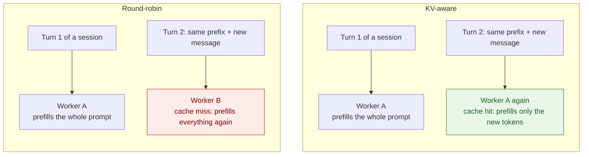
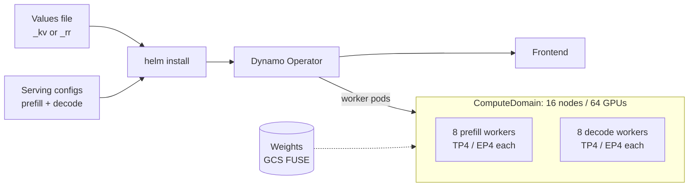
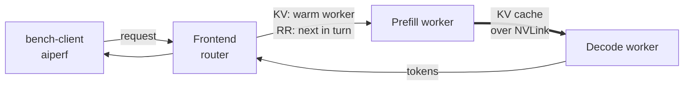
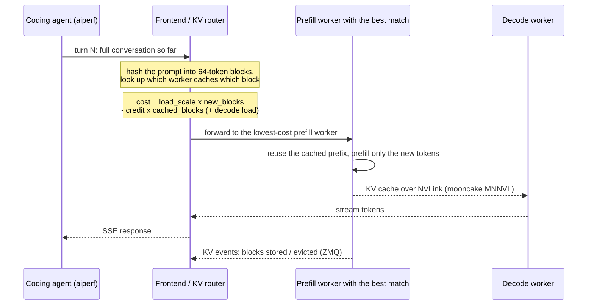

# KV-Aware vs. Round-Robin Routing: Nemotron-3-Ultra 8P8D (64 GPUs) on A4X-MAX

This recipe compares two Dynamo routing policies for [NVIDIA Nemotron-3-Ultra 550B-A55B (NVFP4)](https://huggingface.co/nvidia/NVIDIA-Nemotron-3-Ultra-550B-A55B-NVFP4) serving coding-agent traffic on [A4X-MAX (GB300)](https://cloud.google.com/compute/docs/accelerator-optimized-machines#a4x-vms) GKE nodes. Both arms run the same 8 prefill + 8 decode workers (TP4/EP4, one per GB300 node) in one 16-node NVL72 `ComputeDomain`. Only the frontend router changes:

* **KV-aware (KV)** sends each turn to the worker that already caches the longest prefix of the conversation.
* **Round-robin (RR)** sends requests to workers in turn and ignores what they cache.

It builds on the shared setup of the [parent recipe](../README.md). The same comparison for the other layout is the [aggregated comparison](../../../aggregated-serving/dynamo/nemotron3-ultra-kv-vs-rr/README.md).

<a name="table-of-contents"></a>
## Table of Contents

* [1. Why Routing Matters for Agents](#why-routing)
* [2. Files](#files)
* [3. Architecture](#architecture)
  * [3.1. What Gets Deployed](#what-gets-deployed)
  * [3.2. Request Path](#request-path)
  * [3.3. How the KV-Aware Router Picks a Worker](#router-decision)
* [4. Deploy](#deploy)
  * [4.1. One-Time Setup](#setup)
  * [4.2. Deploy the KV-Aware Arm](#deploy-kv)
  * [4.3. Deploy the Round-Robin Arm](#deploy-rr)
* [5. Run the A/B Benchmark](#ab-benchmark)
* [6. Router Tuning](#router-tuning)
* [7. Monitoring and Troubleshooting](#monitoring)
* [8. Cleanup](#cleanup)

<a name="why-routing"></a>
## 1. Why Routing Matters for Agents

[Back to Top](#table-of-contents)

A coding agent resends the whole conversation on every turn: the system prompt, the files it has read and every earlier tool call. Each new turn shares almost all of its prompt with the previous one. Whether that shared prefix is reused depends on which worker the turn lands on:



With round-robin, consecutive turns of a session usually land on different workers, so each worker recomputes a prompt that another worker already has in cache. With KV-aware routing, the turn returns to the warm worker and only the new tokens are prefilled. Prompts in this workload run up to 262,144 tokens, so that difference dominates time to first token (TTFT) and throughput.

<a name="files"></a>
## 2. Files

[Back to Top](#table-of-contents)

The two values files are identical except for the frontend router settings and the deployment name, so the comparison runs on exactly the same workers:

| File | Routing | Purpose |
| :--- | :--- | :--- |
| [`nemotron3_ultra_8p8d_kv.yaml`](nemotron3_ultra_8p8d_kv.yaml) | KV-aware | Helm values: topology, worker env and the tuned KV router (`DYN_ROUTER_MODE=kv`, overlap credit `1.5`). |
| [`nemotron3_ultra_8p8d_rr.yaml`](nemotron3_ultra_8p8d_rr.yaml) | Round-robin | Helm values: the same topology and worker env with `DYN_ROUTER_MODE=round-robin`. |
| [`nemotron3-ultra-nvfp4-8p8d-prefill.yaml`](../../../../../src/frameworks/a4xmax/dynamo-configs/nemotron3-ultra-nvfp4-8p8d-prefill.yaml) | Both | SGLang arguments for the 8 prefill workers. |
| [`nemotron3-ultra-nvfp4-8p8d-decode.yaml`](../../../../../src/frameworks/a4xmax/dynamo-configs/nemotron3-ultra-nvfp4-8p8d-decode.yaml) | Both | SGLang arguments for the 8 decode workers. |
| [`bench_client.yaml`](../bench_client.yaml) | Both | `aiperf` benchmark client pod. |
| [`dynamo-sglang-n3u.Dockerfile`](../../../../../src/docker/dynamo-sglang-n3u/dynamo-sglang-n3u.Dockerfile) | Both | Serving image build. |

<a name="architecture"></a>
## 3. Architecture

[Back to Top](#table-of-contents)

<a name="what-gets-deployed"></a>
### 3.1. What Gets Deployed



| Component | What it does in this recipe |
| :--- | :--- |
| **ComputeDomain** (`numNodes: 16`) | Places all 16 worker pods in one NVL72 domain and hands each pod an IMEX channel, so NVLink works across nodes. |
| **Frontend** | Tokenizes requests (workers run with `--skip-tokenizer-init`), keeps a global index of which worker caches which 64-token KV block, and routes each request. |
| **Prefill workers** | `--disaggregation-mode prefill`, chunked prefill of 16,384 tokens, at most 8 running requests each. They publish KV events to the router over ZMQ. |
| **Decode workers** | `--disaggregation-mode decode`, up to 64 running requests each. They pull the KV cache from the prefill worker with mooncake over NVLink. |
| **bench-client** | Replays the public SemiAnalysis AgentX coding traces with `aiperf` ([section 5](#ab-benchmark)). |

<a name="request-path"></a>
### 3.2. Request Path



Each request goes to the frontend, which picks a prefill worker. The prefill worker computes the prompt's KV cache and hands it to a decode worker over NVLink. The decode worker streams the output tokens back. The only thing that differs between the two arms is how the frontend picks the prefill worker.

<a name="router-decision"></a>
### 3.3. How the KV-Aware Router Picks a Worker



In the round-robin arm, the frontend skips the prefix lookup and cost calculation and forwards each request to the next worker in turn.

<a name="deploy"></a>
## 4. Deploy

[Back to Top](#table-of-contents)

<a name="setup"></a>
### 4.1. One-Time Setup

1. Complete sections 2.1 to 2.6 of the [parent recipe](../README.md#environment-setup): clone the repository, configure variables, connect to the cluster, create secrets, install the Dynamo Platform and set up the GCS bucket. Install the platform with `RELEASE_VERSION=1.4.2` or newer, because the values files set `dynamo.releaseVersion: "1.4.2"` to match the runtime inside the image.

2. Build the serving image:

This recipe needs a newer stack than the pre-built runtime image: the SGLang CUDA 13 runtime with `ai-dynamo[sglang]==1.4.2` (which pins SGLang 0.5.16) and FlashInfer 0.6.18, installed the same way as in the measured runs. Build it once into Artifact Registry from [`src/docker/dynamo-sglang-n3u`](../../../../../src/docker/dynamo-sglang-n3u/). Run the build on an Arm (`linux/arm64`) host with Docker, for example an Arm VM or a GB300 node, and authenticate Docker to Artifact Registry first:

```bash
export ARTIFACT_REGISTRY="${CLUSTER_REGION}-docker.pkg.dev/${PROJECT_ID}/<YOUR_DOCKER_REPOSITORY>"
gcloud auth configure-docker ${CLUSTER_REGION}-docker.pkg.dev
cd $REPO_ROOT/src/docker/dynamo-sglang-n3u
docker buildx build --platform linux/arm64 \
    -f dynamo-sglang-n3u.Dockerfile \
    -t ${ARTIFACT_REGISTRY}/dynamo-sglang-n3u:1.4.2 --push .
export DYNAMO_IMAGE="${ARTIFACT_REGISTRY}/dynamo-sglang-n3u:1.4.2"
```

> [!NOTE]
> The image is `linux/arm64`, because GB300 nodes are Arm-based. A native Arm build takes a few minutes. Cross-building on an x86 host under QEMU emulation works, but it takes well over an hour. Sections 4.2 and 4.3 pass `${DYNAMO_IMAGE}` to both `workload.image` and `dynamo.frontend.image`.

> [!NOTE]
> The image intentionally overrides two pins. FlashInfer 0.6.18 replaces the 0.6.14 that SGLang 0.5.16 pins, and it is installed with `--no-deps`, so the `nvidia-cutlass-dsl==4.6.0` that SGLang pins stays even though FlashInfer 0.6.18 declares `>=4.6.2a0`. The image records the resolved packages in `/opt/dynamo-sglang-n3u-packages.txt` and the `pip check` output in `/opt/dynamo-sglang-n3u-pip-check.txt`. That output includes these two conflicts plus a few inherited from the SGLang base image. The section 4.2 smoke test passes with all of them in place. Section 4.2 shows how to check that the image imports cleanly and serves a request on the GPUs.

3. Stage the weights once. They mount at `/data/model/nvidia/NVIDIA-Nemotron-3-Ultra-550B-A55B-NVFP4`:

```bash
hf download nvidia/NVIDIA-Nemotron-3-Ultra-550B-A55B-NVFP4 --local-dir ./nvidia/NVIDIA-Nemotron-3-Ultra-550B-A55B-NVFP4
gcloud storage cp -r ./nvidia gs://${GCS_BUCKET}/
```

4. Set the variables used by both arms:

```bash
export N3U_ROOT=$RECIPE_ROOT/nemotron3-ultra-kv-vs-rr
export HF_MODEL_ID="nvidia/NVIDIA-Nemotron-3-Ultra-550B-A55B-NVFP4"
```

<a name="deploy-kv"></a>
### 4.2. Deploy the KV-Aware Arm

```bash
cd $N3U_ROOT
helm install -f nemotron3_ultra_8p8d_kv.yaml \
  --set workload.model=${HF_MODEL_ID} \
  --set workload.image=${DYNAMO_IMAGE} \
  --set dynamo.frontend.image=${DYNAMO_IMAGE} \
  --set volumes.gcsfuse.bucketName=${GCS_BUCKET} \
  --set dynamo.namespace=${NAMESPACE} \
  --set dynamo.nodeSelector."cloud\.google\.com/gke-nodepool"=${NODE_POOL} \
  --set-file prefill_serving_config=$REPO_ROOT/src/frameworks/a4xmax/dynamo-configs/nemotron3-ultra-nvfp4-8p8d-prefill.yaml \
  --set-file decode_serving_config=$REPO_ROOT/src/frameworks/a4xmax/dynamo-configs/nemotron3-ultra-nvfp4-8p8d-decode.yaml \
  $USER-n3u-8p8d-kv \
  $REPO_ROOT/src/helm-charts/a4xmax/inference-templates/dynamo-deployment
```

Wait until the frontend and all 16 worker pods are `Running` and `Ready`:

```bash
kubectl get pods -n ${NAMESPACE} -w
```

Loading the 550B checkpoint from GCS FUSE takes a while on first start; the startup probe allows for it. The node-pool selector keeps every worker in one NVLink domain.

Before benchmarking, check the image and the metrics on a running worker, then send one request through the frontend:

```bash
export WORKER_POD="$(kubectl get pods -n ${NAMESPACE} -o name | grep -E -- '-decode-|-prefill-' | head -n1 | cut -d/ -f2)"
# Versions, the recorded pip conflicts, and an import check of the serving packages
kubectl exec -n ${NAMESPACE} ${WORKER_POD} -c main -- bash -c "
  grep -iE '^(ai-dynamo|sglang|flashinfer-python|nvidia-cutlass-dsl)==' /opt/dynamo-sglang-n3u-packages.txt
  cat /opt/dynamo-sglang-n3u-pip-check.txt
  python3 -c 'import sglang, flashinfer, dynamo.sglang; print(\"imports ok\")'
  curl -s localhost:9090/metrics | grep -E 'sglang.*(cache_hit_rate|cached_tokens|prompt_tokens)' | head"

# One chat completion through the frontend
export FRONTEND_HOST="$(kubectl get svc -n ${NAMESPACE} -o name | grep frontend | head -n1 | cut -d/ -f2)"
kubectl run smoke-$RANDOM -n ${NAMESPACE} --rm -i --restart=Never --image=curlimages/curl -- \
  curl -s http://${FRONTEND_HOST}:8000/v1/chat/completions -H 'Content-Type: application/json' \
  -d '{"model":"'${HF_MODEL_ID}'","messages":[{"role":"user","content":"Say hello."}],"max_tokens":16}'
```

The metrics scrape should list the SGLang cache-hit or cached/prompt token series, which the [`enable-metrics: true`](../../../../../src/frameworks/a4xmax/dynamo-configs/) setting in the serving configs turns on. Without it, `/metrics` shows only the Dynamo series.

<a name="deploy-rr"></a>
### 4.3. Deploy the Round-Robin Arm

Both arms use the same 16 nodes, so run them one at a time. Uninstall the KV arm, wait until its pods and `ComputeDomain` are gone, then install the round-robin file with the same command:

```bash
helm uninstall $USER-n3u-8p8d-kv -n ${NAMESPACE}
kubectl get pods,computedomains -n ${NAMESPACE} -w   # wait until the KV arm is gone

cd $N3U_ROOT
helm install -f nemotron3_ultra_8p8d_rr.yaml \
  --set workload.model=${HF_MODEL_ID} \
  --set workload.image=${DYNAMO_IMAGE} \
  --set dynamo.frontend.image=${DYNAMO_IMAGE} \
  --set volumes.gcsfuse.bucketName=${GCS_BUCKET} \
  --set dynamo.namespace=${NAMESPACE} \
  --set dynamo.nodeSelector."cloud\.google\.com/gke-nodepool"=${NODE_POOL} \
  --set-file prefill_serving_config=$REPO_ROOT/src/frameworks/a4xmax/dynamo-configs/nemotron3-ultra-nvfp4-8p8d-prefill.yaml \
  --set-file decode_serving_config=$REPO_ROOT/src/frameworks/a4xmax/dynamo-configs/nemotron3-ultra-nvfp4-8p8d-decode.yaml \
  $USER-n3u-8p8d-rr \
  $REPO_ROOT/src/helm-charts/a4xmax/inference-templates/dynamo-deployment
```

Reinstalling also gives each arm a cold KV cache, so neither arm starts with the other's cached prefixes.

<a name="ab-benchmark"></a>
## 5. Run the A/B Benchmark

[Back to Top](#table-of-contents)

The benchmark replays the public SemiAnalysis AgentX coding traces with [`aiperf`](https://github.com/ai-dynamo/aiperf). Use the 256K variant of the dataset, which drops sessions longer than the 262,144-token context the workers are configured with.

1. Deploy the benchmark client once. It stays up across both arms:

```bash
kubectl apply -f $RECIPE_ROOT/bench_client.yaml -n ${NAMESPACE}
kubectl logs -f pod/bench-client -n ${NAMESPACE}   # wait for: --- SETUP COMPLETE. POD IS READY. ---
```

2. With one arm deployed, set the target and label the run with the arm (`kv` or `rr`):

```bash
export ROUTING=kv   # or rr
export FRONTEND_HOST="$(kubectl get svc -n ${NAMESPACE} -o name | grep frontend | head -n1 | cut -d/ -f2)"
export WORKER_METRICS="$(kubectl get pods -n ${NAMESPACE} -o jsonpath='{range .items[*]}{.metadata.name}{" "}{.status.podIP}{"\n"}{end}' | awk '/-decode-|-prefill-/ && $2 != "" {printf "%s:9090/metrics ", $2}')"
export CONCURRENCY=96
```

3. Run one profiling point:

```bash
kubectl exec -it bench-client -n ${NAMESPACE} -- bash -c "
  aiperf profile \
    --scenario inferencex-agentx-mvp \
    --url http://${FRONTEND_HOST}:8000 \
    --endpoint /v1/chat/completions \
    --model ${HF_MODEL_ID} \
    --tokenizer ${HF_MODEL_ID} \
    --concurrency ${CONCURRENCY} \
    --random-seed 42 \
    --benchmark-duration 3600 \
    --failed-request-threshold 0.10 \
    --warmup-requests-per-lane 10 \
    --trace-idle-gap-cap-seconds 300 \
    --warmup-grace-period 1800 \
    --tokenizer-trust-remote-code \
    --server-metrics ${WORKER_METRICS} \
    --output-artifact-dir /logs/agentic/aiperf_artifacts/${ROUTING}_c${CONCURRENCY} \
    --public-dataset semianalysis_cc_traces_weka_062126_256k
"
```

4. Sweep `CONCURRENCY` for both arms, for example over `48 72 96 192 384 480 576`. Concurrency counts live agent sessions, not simultaneous HTTP requests. Round-robin saturates at a much lower concurrency than KV-aware routing, so keep the low points for both arms and extend the KV-aware arm upward until its TTFT passes your target.

To keep the comparison fair:

* Use the same `aiperf` command, dataset, duration, concurrency points and `--random-seed` for both arms. Only the values file changes. The seed picks where each agent session starts in its trace; without it, `aiperf` draws a new seed per run and the two arms replay different workloads. To report a quantitative gain, repeat each pair over a few seeds.
* Start each arm from a fresh install (section 4.3), so both begin with a cold cache.
* Compare the arms at the same latency target rather than only at the same concurrency. For each arm, take the highest-throughput point whose TTFT p95 meets your target.

What to compare for each point:

| Metric | Where to read it | What it tells you |
| :--- | :--- | :--- |
| TTFT p95 | `aiperf` summary | How long a turn waits before its first token. Re-prefilling long prompts shows up here first. |
| Total tokens/s per GPU | `aiperf` input + output tokens/s, divided by 64 | Serving capacity of the fleet, including cached prompt tokens. |
| Output tokens/s per user | `aiperf` summary | Interactivity seen by each agent session. |
| Prefix cache-hit rate | Worker `/metrics`, collected through `--server-metrics` | How much of each prompt was reused. This is the mechanism behind the TTFT gap. |
| Request errors | `aiperf` summary | A point with errors past the threshold is not a valid operating point. |

<a name="router-tuning"></a>
## 6. Router Tuning

[Back to Top](#table-of-contents)

The KV-aware arm's router is configured through frontend environment variables in [`nemotron3_ultra_8p8d_kv.yaml`](nemotron3_ultra_8p8d_kv.yaml). Each flag maps to a `DYN_` variable, for example `--router-kv-overlap-score-credit` becomes `DYN_ROUTER_KV_OVERLAP_SCORE_CREDIT`:

| Frontend variable | Default | This recipe | Effect |
| :--- | :--- | :--- | :--- |
| `DYN_ROUTER_MODE` | `round-robin` | `kv` | Route by cached-prefix overlap instead of in turn. [`nemotron3_ultra_8p8d_rr.yaml`](nemotron3_ultra_8p8d_rr.yaml) sets `round-robin` for an A/B baseline with the same workers. |
| `DYN_KV_CACHE_BLOCK_SIZE` | unset | `64` | Must equal the workers' `--page-size`. |
| `DYN_ROUTER_KV_OVERLAP_SCORE_CREDIT` | `1.0` | `1.5` | How much each already-cached block lowers a worker's cost. A higher value sticks a session to its warm worker for longer. |
| `DYN_ROUTER_PREFILL_LOAD_SCALE` | `1.0` | default | How much queued prefill work raises a worker's cost. Raising it helps aggregated workers (see the [aggregated comparison](../../../aggregated-serving/dynamo/nemotron3-ultra-kv-vs-rr/README.md)); it did not help the 8P8D layout, where decode runs on separate GPUs. |
| `DYN_ROUTER_TEMPERATURE` | `0` | `0` | `0` always picks the best worker. Softmax sampling (`>0`) lowered the cache-hit rate and raised TTFT in our sweeps; leave it at `0`. |

What we observed when validating this recipe on the AgentX workload:

* **KV-aware routing is the single biggest lever.** Under the same TTFT target, the KV router sustained several times the session concurrency and throughput of round-robin on the same 64 GPUs, with a much higher prefix cache-hit rate.
* **Overlap credit `1.5` is the one tuning that helped 8P8D.** It lowered TTFT at equal throughput versus the default credit. A credit of `2.0` brought nothing extra.
* **Decaying the overlap credit over time and adding sampling temperature both made results worse.** They are left at their defaults.
* **The round-robin baseline saturates early.** Its TTFT grows quickly with concurrency because every worker prefills every prompt from scratch.

<a name="monitoring"></a>
## 7. Monitoring and Troubleshooting

[Back to Top](#table-of-contents)

Find pod names with `kubectl get pods -n ${NAMESPACE}`, then follow the logs:

```bash
kubectl logs -f <frontend-pod-name> -c main -n ${NAMESPACE}
kubectl logs -f <worker-pod-name> -c main -n ${NAMESPACE}
```

The frontend logs show the routing decisions. Prefill and decode worker logs show request admission and cache reuse.

Common issues:

* **Pods stuck in `Pending` with `waiting for ComputeDomain`**: the `ComputeDomain` needs exactly 16 free GB300 nodes in the selected node pool. Check `kubectl get computedomains -n ${NAMESPACE}` and node availability.
* **The second arm fails to install**: both values files use the same `ComputeDomain` name. Uninstall the first arm and wait for its pods and `ComputeDomain` to disappear before installing the other one (section 4.3).
* **KV transfer not on NVLink**: with `MC_TE_METRIC=true` the decode logs print mooncake transfer metrics, which should report the NVLink/MNNVL protocol. If they show `tcp`, check that `MC_FORCE_MNNVL=1` is set and that all workers landed in the same `ComputeDomain`.
* **Round-robin TTFT climbs steeply**: this is the expected behavior the comparison measures, not a fault. Stop raising round-robin concurrency once its prefill queue no longer drains.

<a name="cleanup"></a>
## 8. Cleanup

[Back to Top](#table-of-contents)

```bash
helm uninstall $USER-n3u-8p8d-kv -n ${NAMESPACE} --ignore-not-found
helm uninstall $USER-n3u-8p8d-rr -n ${NAMESPACE} --ignore-not-found
kubectl delete -f $RECIPE_ROOT/bench_client.yaml -n ${NAMESPACE} --ignore-not-found=true
```

To remove the Dynamo Platform and the namespace as well, follow the [parent recipe's cleanup](../README.md#cleanup).
