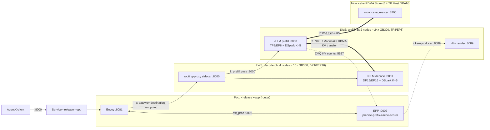

# Kimi-K3.1-Pro on A4X-MAX (NVIDIA GB300 NVL72) with vLLM: llm-d prefill/decode disaggregation (3P1D), Mooncake RDMA, AgentX benchmark

This recipe serves [`moonshotai/Kimi-K3.1-Pro`](https://huggingface.co/moonshotai/Kimi-K3.1-Pro) (1T total / 32B active hybrid MLA + KDA linear-attention MoE model) at **1,048,576 (`1M`) context length** with [vLLM](https://github.com/vllm-project/vllm) on GKE A4X-MAX (`a4x-max-highgpu-4g`, NVIDIA GB300 NVL72) using [llm-d](https://github.com/llm-d/llm-d) prefill/decode (P/D) disaggregation, and benchmarks it with the InferenceX **AgentX** agentic-coding workload.

- **Topology (3P1D across 10 nodes / 40× GB300 GPUs)**:
  - **Prefill (`3× TP8/EP8`, 6 nodes / 24 GPUs)**: three `LeaderWorkerSet` replicas (`size: 2` nodes / 8 GPUs each), tensor parallel 8 (TP8) and expert parallel 8 (EP8) over Multi-Node NVLink (`ComputeDomain`), `nvfp4_ds_mla` KV cache, `FULL_AND_PIECEWISE` CUDA graphs up to 8192 tokens, MXFP8 projection quantization, `DSpark` (`K=5`, `rejection_sample_method: "block"`) speculative decoding, prefix caching on, ZMQ KV cache events on `:5557`, and a co-located `vllm launch render` tokenizer server on `:8089`.
  - **Decode (`1× DP16/EP16/TP1`, 4 nodes / 16 GPUs)**: one `LeaderWorkerSet` replica (`size: 4` nodes / 16 GPUs), data parallel 16 (DP16, `data_parallel_size_local=4`) and expert parallel 16 (EP16) over MNNVL, `nvfp4_ds_mla` KV cache, `use_replayssm` for KDA linear-attention state replay, MXFP8 projection + shared-expert quantization, and `DSpark` (`K=5`, `rejection_sample_method: "block"`) speculative decoding.
- **KV cache & transfer (`MultiConnector`: NIXL + Mooncake RDMA)**:
  - `NixlConnector` (`kv_buffer_device: "cuda"`) transfers freshly computed KV blocks from prefill to decode over GPUDirect RDMA RoCE (`mrdma.google.com`).
  - `MooncakeStoreConnector` connects all 40 engine ranks to a distributed **Mooncake RDMA DRAM store** (`160 GB` host DRAM segment per GPU rank = **6.4 TB** cluster-wide Tier-2 KV store coordinated by `mooncake_master` on `:8700`) so evicted multi-turn prefixes are fetched asynchronously over RDMA instead of recomputed.
- **Router**: the llm-d Endpoint Picker (EPP) in **standalone** mode paired with an Envoy proxy in the same pod. The EPP tokenizes incoming chat prompts via the prefill `vllm launch render` servers (`token-producer` on `:8089`), tracks live GPU and Mooncake DRAM KV block placement via ZMQ (`precise-prefix-cache-producer` on `:5557` with `blockSizeTokens: 2048`), and scores prefill and decode endpoints without requiring Gateway API CRDs or a cloud load balancer.
- **Client**: the InferenceX AIPerf build running the `inferencex-agentx-mvp` scenario on the [`semianalysisai/cc-traces-weka-062126`](https://huggingface.co/datasets/semianalysisai/cc-traces-weka-062126) 1M-context traces (multi-turn coding sessions averaging ~116k input tokens and ~900 output tokens per request), streaming, at concurrency 336 for 3600 s after a per-lane warmup.



For each request, the EPP tokenizes the prompt via `:8089`, matches 2048-token prefix blocks against its live ZMQ index, and selects both a prefill replica and the decode replica. Envoy forwards the request to the `routing-proxy` sidecar on the decode leader pod (`:8000`), which executes the prefill pass on the chosen prefill leader (`:8000`), transfers the KV cache over GPUDirect RDMA (NIXL / Mooncake), and streams the generated tokens from the local decode engine (`:8001`).

## Versions

This recipe was validated with:

| Component | Image |
| --- | --- |
| vLLM (prefill, decode, and Mooncake master) | `docker.io/vllm/vllm-openai:kimi-k31@sha256:904520f3fefc32414abcedf6ba8dadc9c5978db1bcdaf40f58d6b9036ef30a99` |
| llm-d Endpoint Picker (EPP v0.10.0) | `ghcr.io/llm-d/llm-d-router-endpoint-picker@sha256:2e516fa1310da7be59b82beb1445362139597d6d553ef04d546716abe3aaaa70` |
| llm-d routing sidecar | `ghcr.io/llm-d/llm-d-router-disagg-sidecar:v0.10.0` |
| Envoy | `docker.io/envoyproxy/envoy:distroless-v1.33.2` |
| InferenceX AgentX client | `us-central1-docker.pkg.dev/supercomputer-testing/joeywan-ubench/inferencex-agentx@sha256:757399e68f02a3869d72138329287cec48353b01432a0053468fdbd133128896` |

## Prerequisites

- A GKE cluster with **10 `a4x-max-highgpu-4g` (NVIDIA GB300 NVL72) nodes** (40 GPUs total) in the same NVLink domain, plus a system/CPU node (or spare capacity) for the router and client pods.
- [LeaderWorkerSet](https://lws.sigs.k8s.io/docs/installation/) controller installed on the cluster.
- NVIDIA DRA driver (`resource.nvidia.com/v1beta1` `ComputeDomain` for MNNVL) and GKE DRANET RDMA driver (`mrdma.google.com` `ResourceClaimTemplate` for `gpu0`..`gpu3` RoCE NICs) installed on the cluster.
- Egress from the cluster to Hugging Face, Docker Hub, and `ghcr.io`.
- A Hugging Face token with read access to `moonshotai/Kimi-K3.1-Pro`, `Inferact/Kimi-K3.1-Pro-DSpark-preview`, and `semianalysisai/cc-traces-weka-062126`.

Placeholders in `values.yaml`:

| Value | Default | Set it to |
| --- | --- | --- |
| `hf_token` | `""` | Your Hugging Face token. Pass it with `--set hf_token=${HF_TOKEN}`. |
| `reservation` | `""` | Optional: your A4X-MAX GCE reservation name. |
| `node_selector` | `{}` | Optional: extra nodeSelector labels for GPU pods (e.g., `--set node_selector."cloud\.google\.com/gke-nodepool"=np-3`). |
| `service_account` | `""` | Optional: Kubernetes ServiceAccount for pods. |
| `kueue.queue_name`, `kueue.priority_class` | `""` | Optional: your Kueue LocalQueue and priority class, if the cluster uses Kueue. |
| `data_volume.host_path`, `model_path` | `""` | Optional: host directory on node local SSD (e.g., `/mnt/stateful_partition/kube-ephemeral-ssd/llmd-k3-cache`) and pre-staged model path (e.g., `/data/models/Kimi-K3.1-Pro`) to skip cold Hugging Face downloads across restarts. |
| `engine.image`, `client.image` | see [Versions](#versions) | Images your cluster can pull. |

## Deploy

### Configure kubectl to communicate with your cluster

```shell
gcloud container clusters get-credentials ${CLUSTER_NAME} --location=${LOCATION} --project=${PROJECT_ID}
```

### Install the chart

In this directory, run:

```shell
export RUN_NAME="kimi-k31-pd"
export HF_TOKEN="<YOUR_HF_TOKEN>"

helm install ${RUN_NAME} . --set hf_token=${HF_TOKEN}
```

If targeting a specific node pool (such as `np-3`) or pre-staged local SSD cache, pass:

```shell
helm install ${RUN_NAME} . \
  --set hf_token=${HF_TOKEN} \
  --set node_selector."cloud\.google\.com/gke-nodepool"=np-3 \
  --set data_volume.host_path=/mnt/stateful_partition/kube-ephemeral-ssd/llmd-k3-cache
```

The chart creates:
- `${RUN_NAME}-compute-domain` (`ComputeDomain` spanning 10 nodes) and `${RUN_NAME}-gke-rdma-claim-gb300` (`ResourceClaimTemplate`),
- `${RUN_NAME}-llm-d-mooncake-master` (`Deployment` + `Service`) and `${RUN_NAME}-llm-d-mooncake-config` (`ConfigMap`),
- `${RUN_NAME}-llm-d-prefill` (`LeaderWorkerSet`, `replicas: 3`, `size: 2` = 6 pods / 24 GPUs),
- `${RUN_NAME}-llm-d-decode` (`LeaderWorkerSet`, `replicas: 1`, `size: 4` = 4 pods / 16 GPUs),
- `${RUN_NAME}-epp` (`Deployment` + `Service` on `:8000`) and `${RUN_NAME}-model-server-svc` (`Service` on `:8000` and `:8089`),
- `${RUN_NAME}-client` (`Job`).

Every object is labelled `app.kubernetes.io/instance=${RUN_NAME}`:

```shell
kubectl get pods -l app.kubernetes.io/instance=${RUN_NAME} -o wide
```

Monitor the prefill and decode leader startup logs:

```shell
kubectl logs -f ${RUN_NAME}-llm-d-prefill-0 -c vllm
kubectl logs -f ${RUN_NAME}-llm-d-decode-0 -c vllm
```

> [!IMPORTANT]
> Send traffic only to the `${RUN_NAME}-epp` Service (port `8000` or `80`). Sending traffic directly to decode port `8001` or to the prefill pods skips P/D disaggregation.

## Verify P/D, Mooncake RDMA, and NIXL KV Transfer

1. Send a test chat completion request through the router:

   ```shell
   kubectl port-forward svc/${RUN_NAME}-epp 8000:8000 &
   curl -s http://localhost:8000/v1/models
   curl -s http://localhost:8000/v1/chat/completions \
     -H 'Content-Type: application/json' \
     -d '{
       "model": "moonshotai/Kimi-K3.1-Pro",
       "messages": [{"role": "user", "content": "Write a Python function to merge two sorted lists."}],
       "max_tokens": 256
     }'
   ```

2. Confirm that all 40 engine ranks registered with the Mooncake RDMA master and that the router's ZMQ KV index is receiving events:

   ```shell
   kubectl logs deploy/${RUN_NAME}-llm-d-mooncake-master | tail -20
   kubectl logs deploy/${RUN_NAME}-epp -c router | tail -20
   ```

3. Confirm `DSpark` speculative decoding (`K=5`, block rejection) and KV cache utilization on the decode leader pod:

   ```shell
   kubectl logs ${RUN_NAME}-llm-d-decode-0 -c vllm | grep -E "SpecDecoding metrics|External prefix cache hit rate" | tail -10
   ```

## Run the Benchmark

The `${RUN_NAME}-client` Job waits until `http://${RUN_NAME}-epp:8000/v1/chat/completions` serves a warmup completion, warms up each of the 336 concurrent agent lanes, runs the 3600 s measurement window against the 1M-context AgentX dataset (`semianalysis_cc_traces_weka_062126`), and prints an AIPerf JSON summary at the end:

```shell
kubectl logs -f job/${RUN_NAME}-client
```

### Customize the Benchmark

All settings live in [`values.yaml`](./values.yaml):

- `client.concurrency`, `client.benchmark_duration_s`, `client.warmup_requests_per_lane`: the AgentX load. Set `client.enabled=false` to deploy only the serving stack.
- `mooncake.protocol`, `mooncake.global_segment_size`, `mooncake.donor_replicas`: Mooncake distributed DRAM store configuration.
- `engine.env` / `engine.args`: environment variables and `vllm serve` flags shared by both prefill and decode engines. `prefill.*` and `decode.*` hold role-specific replica counts, parallelism, quantization targets, and `MultiConnector` settings.
- [`files/epp-config.yaml`](./files/epp-config.yaml): the EPP scheduling profiles (`precise-prefix-cache-producer`, `prefix-cache-scorer`, `session-affinity-scorer`, `active-request-scorer`, `token-load-scorer`, `no-hit-lru-scorer`).

## Troubleshooting

| Symptom | Cause and fix |
| --- | --- |
| Engine pods stay `Pending` with `untolerated taint` or node affinity mismatch | Verify that your GB300 node pool has 10 free nodes and pass `--set node_selector."cloud\.google\.com/gke-nodepool"=<POOL_NAME>` if needed. |
| Engine pods stay `ContainerCreating` waiting on `ResourceClaim` | Check `kubectl get resourceclaims` and verify that the GKE DRANET (`mrdma.google.com`) and NVIDIA `ComputeDomain` drivers are healthy on all 10 nodes. |
| `Couldn't instantiate the backend tokenizer` on startup | The leader startup script automatically installs `sentencepiece` and `tiktoken` if missing and prewarms `trust_remote_code` in a single process before launching `vllm serve`. Ensure cluster egress to PyPI/Hugging Face is available unless weights and wheels are pre-staged. |
| High TTFT or low prefix-cache hit rate across prefill replicas | Check `kubectl logs deploy/${RUN_NAME}-epp -c router` to verify `token-producer` can reach `http://${RUN_NAME}-model-server-svc:8089` and `precise-prefix-cache-producer` has discovered all 3 prefill leader pods on ZMQ port `5557`. |

## Cleanup

Remove all resources created by the chart with:

```shell
helm uninstall ${RUN_NAME}
```
