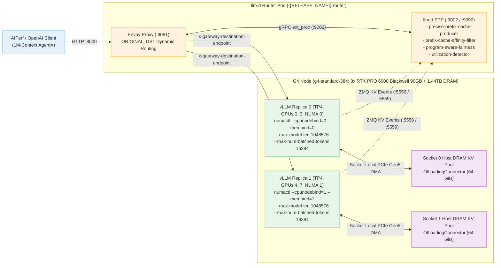

# Aggregated 1M-Context Multi-Turn Inference with llm-d and vLLM on G4 GKE

This document outlines the steps to deploy and benchmark `reflection/Beam-1.0-501B-A23B-NVFP4` (`LASER_BEAM`) at **1,048,576 (`1M`) context length** using the [llm-d](https://github.com/llm-d/llm-d) intelligent inference scheduling stack with the [vLLM](https://docs.vllm.ai/en/latest/) backend on [G4 (`g4-standard-384`, NVIDIA RTX PRO 6000 Blackwell Server Edition) GKE Node pools](https://cloud.google.com/compute/docs/gpus#rtx-6000-gpus).

`llm-d` pairs an Envoy proxy and an `ext_proc` Endpoint Picker (`EPP`) router with vLLM workers to provide real-time ZMQ KV-cache event tracking (`precise-prefix-cache-producer` on `:5556` / `:5559`), multi-tier prefix-affinity routing (`prefix-cache-affinity-filter` across GPU HBM and host DRAM), `program-aware-fairness` multi-turn scheduling (`strategy: turn-priority`), and queue/KV saturation flow control (`utilization-detector`). On `g4-standard-384` nodes (8x RTX PRO 6000 Blackwell Server Edition GPUs with 96 GB GDDR7 each + 1.44 TB host DRAM), this recipe deploys **`2x TP4 / EP4` (`8` GPUs total)** with **host DRAM KV-cache offloading (`OffloadingConnector` / `CPUOffloadingSpec`, `64 GiB` per TP4 replica / `128 GiB` per node)**, socket-local PCIe Gen5 **NUMA pinning (`numactl`)**, and **DFlash2 speculative decoding**.

<a name="table-of-contents"></a>
## Table of Contents

* [1. Test Environment & Benchmark Results](#test-environment)
  * [1.1. Hardware & Software Configuration](#hardware-config)
  * [1.2. Verified 60-Minute 1M-Context AgentX Benchmark Results](#benchmark-results)
* [2. Environment Setup (One-Time)](#environment-setup)
  * [2.1. Clone the Repository](#clone-repo)
  * [2.2. Configure Environment Variables](#configure-vars)
  * [2.3. Connect to your GKE Cluster](#connect-cluster)
  * [2.4. Create Secrets](#create-secrets)
  * [2.5. Setup GCS Bucket for GKE](#setup-gcsfuse)
  * [2.6. Configure Container Images](#configure-images)
* [3. Deploy the 1M-Context llm-d + vLLM Stack (2x TP4)](#deploy-llmd-vllm)
  * [3.1. System Architecture & Key Optimizations](#system-architecture)
  * [3.2. Post-Optimization 1M-Context Tuning Summary](#1m-context-optimizations)
  * [3.3. Option A: Deploy with Helm](#deploy-helm)
  * [3.4. Option B: Deploy with Standalone Kubernetes Manifests](#deploy-manifests)
* [4. Inference Request and Benchmarking](#inference-request)
  * [4.1. Verify Deployment Readiness](#verify-readiness)
  * [4.2. Deploy the Benchmark Client](#deploy-bench-client)
  * [4.3. Agentic Multi-Turn Profiling with AIPerf (1M-Context AgentX Dataset)](#benchmark-aiperf-agentx)
* [5. Monitoring and Troubleshooting](#monitoring)
* [6. Cleanup](#cleanup)

<a name="test-environment"></a>
## 1. Test Environment & Benchmark Results

[Back to Top](#table-of-contents)

<a name="hardware-config"></a>
### 1.1. Hardware & Software Configuration

This recipe has been tested and benchmarked with the following configuration:

* **GKE Cluster**:
    * GPU node pools with [g4-standard-384](https://cloud.google.com/compute/docs/gpus#rtx-6000-gpus) machines (`cloud.google.com/gke-accelerator: nvidia-rtx-pro-6000`, 8x NVIDIA RTX PRO 6000 Blackwell Server Edition `SM120` GPUs with 96 GB GDDR7 each = 768 GB GPU memory per node, 384 vCPUs across 2 NUMA sockets, 1,440 GB host DRAM).
    * **Serving Topology**: `2x TP4 / EP4` (`8` GPUs total across 2 four-GPU instances, NUMA-pinned per 4-GPU PCIe socket via `numactl --cpunodebind={0|1} --membind={0|1}`).
    * [Workload Identity Federation for GKE](https://cloud.google.com/kubernetes-engine/docs/concepts/workload-identity) enabled.
    * [Cloud Storage FUSE CSI driver for GKE](https://cloud.google.com/kubernetes-engine/docs/concepts/cloud-storage-fuse-csi-driver) enabled.

<a name="benchmark-results"></a>
### 1.2. Verified 60-Minute 1M-Context AgentX Benchmark Results

Evaluated using [`aiperf`](https://github.com/ai-dynamo/aiperf) (`--scenario agentx --benchmark-duration 3600`) with the SemiAnalysis AgentX multi-turn coding trajectory dataset (`semianalysis_cc_traces_weka_062126`, up to `1M` context length) across `8` RTX PRO 6000 Blackwell GPUs (`2x TP4`):

| Concurrency | Stack Configuration | Output Throughput (`tok/s/GPU`) | Prefix KV-Cache Hit Rate (`%`) | P90 TTFT (`s`) | Speedup / Improvement (`llm-d` vs. Baseline) |
| :--- | :--- | :--- | :--- | :--- | :--- |
| **`c=8`** | **llm-d + vLLM (DRAM Offload)** | **`39.7 tok/s/GPU`** | **`95.9%`** | — | **+13.4% Throughput**, **+3.5% KV Hit Rate** |
| **`c=8`** | Standalone vLLM Baseline | `35.0 tok/s/GPU` | `92.4%` | — | *(Reference)* |
| **`c=16`** | **llm-d + vLLM (DRAM Offload)** | **`51.3 tok/s/GPU`** | **`88.5%`** | **`10.26s`** | **+95.8% (1.96x) Throughput**, **+34.4% KV Hit**, **11.3x Lower P90 TTFT** |
| **`c=16`** | Standalone vLLM Baseline | `26.2 tok/s/GPU` | `54.1%` | `115.70s` | *(Reference — severe HBM KV eviction & recomputation)* |
| **`c=32`** | **llm-d + vLLM (DRAM Offload)** | **`25.5 tok/s/GPU`** | **`59.1%`** | **`195.98s`** | Sustains `59.1%` KV hit rate under `32` concurrent 1M-context sessions |

<a name="environment-setup"></a>
## 2. Environment Setup (One-Time)

[Back to Top](#table-of-contents)

<a name="clone-repo"></a>
### 2.1. Clone the Repository

```bash
git clone https://github.com/ai-hypercomputer/gpu-recipes.git
cd gpu-recipes
export REPO_ROOT=$(pwd)
export RECIPE_ROOT=$REPO_ROOT/inference/g4/aggregated-serving/llm-d
```

<a name="configure-vars"></a>
### 2.2. Configure Environment Variables

```bash
export PROJECT_ID=<PROJECT_ID>
export CLUSTER_REGION=<CLUSTER_REGION>
export CLUSTER_ZONE=<CLUSTER_ZONE>
export CLUSTER_NAME=<CLUSTER_NAME>
export NAMESPACE=llmd-inference
export HF_TOKEN=<HF_TOKEN>
export GCS_BUCKET=<GCS_BUCKET>
export LASER_BEAM_HF_MODEL_ID=reflection/Beam-1.0-501B-A23B-NVFP4
export LASER_BEAM_DRAFTER_HF_MODEL_ID=reflection/Beam-1.0-501B-A23B-DFlash2

# Set the project for gcloud commands
gcloud config set project $PROJECT_ID
```

Replace the following values:

| Variable | Description | Example |
| -------- | ----------- | ------- |
| `PROJECT_ID` | Your Google Cloud Project ID | `<PROJECT_ID>` |
| `CLUSTER_REGION` | The GCP region where your GKE cluster is located | `<CLUSTER_REGION>` |
| `CLUSTER_ZONE` | The GCP zone where your GKE node pool is located (if zonal) | `<CLUSTER_ZONE>` |
| `CLUSTER_NAME` | The name of your GKE cluster | `<CLUSTER_NAME>` |
| `NAMESPACE` | Kubernetes namespace for the deployment | `llmd-inference` |
| `HF_TOKEN` | Your Hugging Face access token | `<HF_TOKEN>` |
| `GCS_BUCKET` | Your GCS bucket name (without `gs://` prefix for Helm `bucketName`) | `<GCS_BUCKET>` |
| `LASER_BEAM_HF_MODEL_ID` | Target model Hugging Face ID | `reflection/Beam-1.0-501B-A23B-NVFP4` |
| `LASER_BEAM_DRAFTER_HF_MODEL_ID` | DFlash2 speculative drafter Hugging Face ID | `reflection/Beam-1.0-501B-A23B-DFlash2` |

<a name="connect-cluster"></a>
### 2.3. Connect to your GKE Cluster

```bash
gcloud container clusters get-credentials $CLUSTER_NAME --region $CLUSTER_REGION
```

<a name="create-secrets"></a>
### 2.4. Create Secrets

Create the namespace:
```bash
kubectl create namespace ${NAMESPACE} --dry-run=client -o yaml | kubectl apply -f -
kubectl config set-context --current --namespace=$NAMESPACE
```

Create the secret for the Hugging Face token:
```bash
kubectl create secret generic hf-token-secret \
  --from-literal=HF_TOKEN=${HF_TOKEN} \
  -n ${NAMESPACE}
```

<a name="setup-gcsfuse"></a>
### 2.5. Setup GCS Bucket for GKE (One-Time Setup)

If storing model weights in Google Cloud Storage, utilize [Cloud Storage FUSE (`gcsfuse`)](https://cloud.google.com/kubernetes-engine/docs/how-to/cloud-storage-fuse-csi-driver-setup) to facilitate fast parallel model loading:

```bash
export SERVICE_ACCOUNT_EMAIL=$(kubectl get serviceaccount/default -n ${NAMESPACE} -o jsonpath='{.metadata.annotations.iam\.gke\.io/gcp-service-account}')

gcloud iam service-accounts add-iam-policy-binding ${SERVICE_ACCOUNT_EMAIL} \
    --role roles/iam.workloadIdentityUser \
    --member "serviceAccount:${PROJECT_ID}.svc.id.goog[${NAMESPACE}/default]"

gcloud storage buckets add-iam-policy-binding gs://${GCS_BUCKET} \
    --member "serviceAccount:${SERVICE_ACCOUNT_EMAIL}" \
    --role "roles/storage.objectViewer"
```

<a name="configure-images"></a>
### 2.6. Configure Container Images

Set your environment variables for the vLLM engine image (built with `SM120` Blackwell support, `flashinfer_cutlass` MoE kernels, DFlash2 speculative decoding, and `OffloadingConnector` KV-cache CPU offloading) and the `llm-d` Endpoint Picker (`EPP`) router image:

```bash
export VLLM_IMAGE="us-central1-docker.pkg.dev/gpu-launchpad-playground/vllm/vllm-beam:lin-tracking-cu13-8e0922e8-sm120-x86_64"
export EPP_IMAGE="ghcr.io/llm-d/llm-d-router-endpoint-picker:main"
```

<a name="deploy-llmd-vllm"></a>
## 3. Deploy the 1M-Context llm-d + vLLM Stack (2x TP4)

[Back to Top](#table-of-contents)

<a name="system-architecture"></a>
### 3.1. System Architecture & Key Optimizations



<a name="1m-context-optimizations"></a>
### 3.2. Post-Optimization 1M-Context Tuning Summary

| Component & Optimization | Configured Value | Purpose on 1M-Context Multi-Turn Workloads |
| :--- | :--- | :--- |
| **#1 NUMA Pinning (`numactl`)** | `numactl --cpunodebind=0 --membind=0` (GPUs `0..3`), `numactl --cpunodebind=1 --membind=1` (GPUs `4..7`) | Keeps PCIe Gen5 CPU<->GPU KV-cache DMA transfers and worker threads 100% socket-local without QPI/UPI cross-socket traversal. |
| **#2 Host DRAM KV-Cache Offloading (`OffloadingConnector` / `CPUOffloadingSpec`)** | `cpu_bytes_to_use: 68719476736` (`64 GiB` per TP4 replica = `128 GiB/node` for 2x TP4/node; or `137438953472` = `128 GiB/replica` for 1x TP4/node), `blocks_per_chunk: 16`, `offload_prompt_only: true` | Extends effective KV-cache capacity into `g4-standard-384` host DRAM and publishes ZMQ tier events (`:5556` / `:5559`, `gpu: 1.0`, `cpu: 0.4`) so evicted multi-turn prefixes are reloaded via PCIe DMA instead of recomputed. |
| **#3 Engine Batching & CUDA Graphs** | `--max-num-batched-tokens 16384`, `--max-num-seqs 16`, `--block-size 64`, `FULL_AND_PIECEWISE` CUDA graphs `1..1152` (`fuse_allreduce_rms: false`) | Cuts 100K–700K prefill chunks in half (updated from `8192` to `16384`), bounds concurrent active sequences (`16`), and captures CUDA graphs up to `1152` tokens for speculative decoding. |
| **#4 DFlash2 Speculative Decoding** | `num_speculative_tokens: 8`, `draft_tensor_parallel_size: 4`, `--no-disable-hybrid-kv-cache-manager`, `--swa-bounded-replay`, `--moe-backend flashinfer_cutlass` | Accelerates decode interactivity (TPOT/ITL) using block-diffusion speculative decoding with bounded sliding-window attention replay. |
| **#5 `llm-d` EPP Routing & Flow Control (`EndpointPickerConfig`)** | `prefix-cache-affinity-filter` (`affinityThreshold: 0.75`, `peakPrefillThroughput: 16444`), `utilization-detector` (`queueDepthThreshold: 6`, `kvCacheUtilThreshold: 0.80`), `program-aware-fairness` (`turn-priority`), `speculativeIndexing: true` | Directs multi-turn agentic sessions to the pod holding their GPU/DRAM prefix (`88.5%` KV hit at `c=16` vs. `54.1%` without `llm-d`, yielding **1.96x higher throughput** and **11.3x lower P90 TTFT**). |

<a name="deploy-helm"></a>
### 3.3. Option A: Deploy with Helm

1. Set the release and model variables:

```bash
export HF_MODEL_ID="${LASER_BEAM_HF_MODEL_ID}"
export DRAFTER_MODEL_ID="${LASER_BEAM_DRAFTER_HF_MODEL_ID}"
export RELEASE_NAME="llmd-inference"
```

2. Install the Helm chart (`$REPO_ROOT/src/helm-charts/g4/llm-d-inference`) using `values.yaml`:

```bash
cd $RECIPE_ROOT
helm install ${RELEASE_NAME} \
  $REPO_ROOT/src/helm-charts/g4/llm-d-inference \
  -f values.yaml \
  --namespace ${NAMESPACE} \
  --set workload.model.name=${HF_MODEL_ID} \
  --set workload.model.drafterName=${DRAFTER_MODEL_ID} \
  --set workload.image=${VLLM_IMAGE} \
  --set llmd.router.eppImage=${EPP_IMAGE}
```

*(Optional)* To mount model weights from Google Cloud Storage via `gcsfuse`, append `--set volumes.useGcs=true --set volumes.gcsfuse.bucketName=${GCS_BUCKET}`. If deploying into a GKE namespace with an existing pre-bound ServiceAccount instead of creating a new Role/RoleBinding, append `--set llmd.router.rbac.create=false --set llmd.router.serviceAccount.create=false --set llmd.router.serviceAccount.name=<SERVICE_ACCOUNT_NAME>`.

<a name="deploy-manifests"></a>
### 3.4. Option B: Deploy with Standalone Kubernetes Manifests

Pre-rendered Kubernetes manifests (`RELEASE_NAME=llmd-inference`) for the `llm-d` router and the `2x TP4` `1M`-context vLLM model server replicas are also available under `$RECIPE_ROOT/manifests/`:

```bash
cd $RECIPE_ROOT
kubectl apply -f manifests/router.yaml -n ${NAMESPACE}
kubectl apply -f manifests/modelserver-2x-tp4-1m.yaml -n ${NAMESPACE}
```

<a name="inference-request"></a>
## 4. Inference Request and Benchmarking

[Back to Top](#table-of-contents)

<a name="verify-readiness"></a>
### 4.1. Verify Deployment Readiness

Before sending inference or benchmark requests, verify that the `llm-d` router (`2/2` containers: `envoy-proxy` + `router`) and both `vLLM` worker pods (`1/1`) are in the `Running` and `Ready` state:

```bash
kubectl get pods -n ${NAMESPACE} -o wide
```

Expected output:
```text
NAME                                READY   STATUS    RESTARTS   AGE
llmd-inference-router-xxxxx-xxxxx   2/2     Running   0          15m
llmd-inference-vllm-0-xxxxx-xxxxx   1/1     Running   0          15m
llmd-inference-vllm-1-xxxxx-xxxxx   1/1     Running   0          15m
```

Verify that the OpenAI `/v1/models` endpoint responds through the frontend Service:
```bash
kubectl run curl-test --rm -i --tty --restart=Never --image=curlimages/curl -n ${NAMESPACE} -- \
  curl -s http://${RELEASE_NAME}-frontend:8000/v1/models
```

<a name="deploy-bench-client"></a>
### 4.2. Deploy the Benchmark Client

Deploy the standalone `bench-client` pod, which installs `aiperf` for AgentX 1M-context multi-turn profiling:

```bash
cd $RECIPE_ROOT
kubectl apply -f bench_client.yaml -n ${NAMESPACE}
```

Wait for `bench-client` to finish setup:
```bash
kubectl logs -f pod/bench-client -n ${NAMESPACE}
```

Proceed once you see `--- SETUP COMPLETE. POD IS READY. ---`.

<a name="benchmark-aiperf-agentx"></a>
### 4.3. Agentic Multi-Turn Profiling with AIPerf (1M-Context AgentX Dataset)

Use [`aiperf`](https://github.com/ai-dynamo/aiperf) with the SemiAnalysis AgentX coding trajectory dataset (`semianalysis_cc_traces_weka_062126`) to evaluate 1M-context multi-turn prefix caching, DRAM KV offloading, and decode interactivity at concurrencies `CONCURRENCY=8`, `16`, or `32`:

```bash
export FRONTEND_HOST="${RELEASE_NAME}-frontend"
export MODEL_NAME="${LASER_BEAM_HF_MODEL_ID}"
export TOKENIZER_PATH="${LASER_BEAM_HF_MODEL_ID}"
export CONCURRENCY=16

kubectl exec -it bench-client -n ${NAMESPACE} -- bash -c "
  aiperf profile \
    --scenario agentx \
    --url http://${FRONTEND_HOST}:8000 \
    --endpoint /v1/chat/completions \
    --model ${MODEL_NAME} \
    --tokenizer ${TOKENIZER_PATH} \
    --concurrency ${CONCURRENCY} \
    --benchmark-duration 3600 \
    --benchmark-grace-period inf \
    --failed-request-threshold 0.50 \
    --warmup-requests-per-lane 10 \
    --trace-idle-gap-cap-seconds 300 \
    --warmup-grace-period 1800 \
    --agentic-warmup-grace-period 1800 \
    --tokenizer-trust-remote-code \
    --server-metrics http://${RELEASE_NAME}-backends:8000/metrics \
    --output-artifact-dir /logs/agentic/aiperf_artifacts/llmd_1m_c${CONCURRENCY} \
    --public-dataset semianalysis_cc_traces_weka_062126
"
```

<a name="monitoring"></a>
## 5. Monitoring and Troubleshooting

[Back to Top](#table-of-contents)

View logs for the `llm-d` router and `vLLM` worker pods:

```bash
# List pods
kubectl get pods -n ${NAMESPACE}

# llm-d EPP router logs (prefix cache hits, affinity scores, flow control admissions)
kubectl logs -f deployment/${RELEASE_NAME}-router -c router -n ${NAMESPACE}

# Envoy proxy logs
kubectl logs -f deployment/${RELEASE_NAME}-router -c envoy-proxy -n ${NAMESPACE}

# vLLM instance 0 & 1 logs (KV cache usage, DRAM offload bandwidth, DFlash2 acceptance rate)
kubectl logs -f deployment/${RELEASE_NAME}-vllm-0 -n ${NAMESPACE}
kubectl logs -f deployment/${RELEASE_NAME}-vllm-1 -n ${NAMESPACE}
```

Inspect real-time Prometheus metrics from the `llm-d` EPP router (`:9090/metrics`):
```bash
kubectl exec -it deployment/${RELEASE_NAME}-router -c router -n ${NAMESPACE} -- \
  wget -qO- http://localhost:9090/metrics | grep -E "inference_pool|prefix_cache|flow_control"
```

<a name="cleanup"></a>
## 6. Cleanup

[Back to Top](#table-of-contents)

List deployed Helm releases:
```bash
helm list -n ${NAMESPACE}
```

Uninstall the deployment and benchmark client:
```bash
helm uninstall ${RELEASE_NAME} -n ${NAMESPACE}
kubectl delete -f $RECIPE_ROOT/bench_client.yaml -n ${NAMESPACE} --ignore-not-found=true
```
